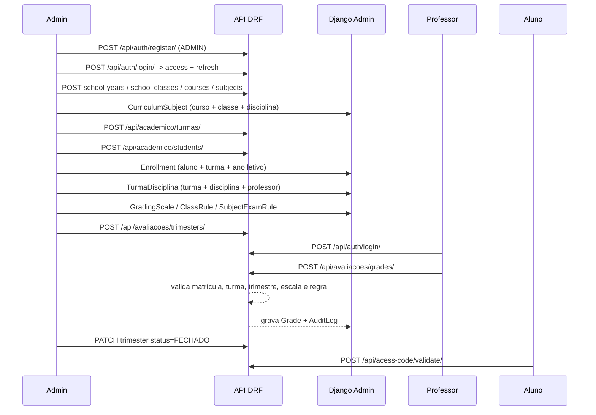
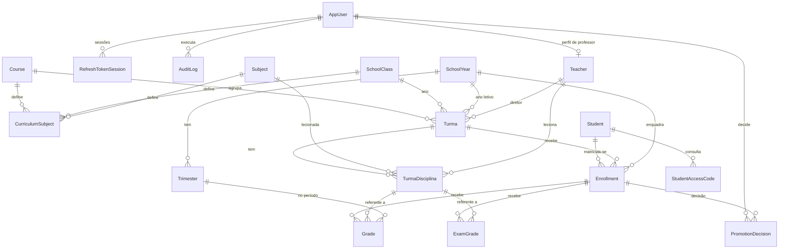

# Fluxo Académico: do primeiro registo ao lançamento de notas

Este documento descreve o percurso completo dos dados no SLN CAF, desde a criação do primeiro utilizador até ao momento em que um professor lança notas. Para cada etapa indica:

- quem executa a ação e com que permissões;
- que endpoint ou ecrã é usado;
- que dados são recebidos;
- que registos são criados ou alterados;
- que entidades passam a depender desses dados.

> **Legenda**
> - **API**: endpoint DRF (`/api/...`).
> - **Admin**: Django admin (`/admin/`), usado porque ainda não existe endpoint público.
> - **Auto**: valor calculado pelo sistema.
> - **Seed**: criado pela migração `0003_seed_grading_rules.py`.

---

## 1. Onde começa o fluxo

Há dois pontos de partida distintos:

1. **Bootstrap do sistema**: criação do primeiro `AppUser` com papel `ADMIN` em `POST /api/auth/register/`.
2. **Início do fluxo académico**: criação do `SchoolYear` (ano letivo), que é a raiz de turmas, matrículas, trimestres e regras efetivas.

O fluxo operacional completo é:

```text
AppUser ADMIN
  -> login (JWT)
  -> SchoolYear + SchoolClass + Course + Subject
  -> CurriculumSubject (plano curricular)
  -> Turma (+ diretor de turma)
  -> Student
  -> Enrollment (matrícula na turma)
  -> TurmaDisciplina (disciplina + professor por turma)
  -> Regras de avaliação (GradingScale, ClassRule, SubjectExamRule)
  -> Trimester
  -> Professor lança Grade (MAC/PP/PT)
  -> Resultados e situação são calculados
  -> Exames, decisão de promoção, códigos de acesso e auditoria
```

### Diagrama de sequência resumido



---

## 2. Modelo de dados e relações



### Tabela de entidades principais

| Entidade | Tabela | Papel no fluxo | Chave estrangeira principal |
|---|---|---|---|
| `AppUser` | `app_user` | Login, papel `ADMIN`/`TEACHER` | - |
| `Teacher` | `teacher` | Perfil profissional, diretor e professor de disciplina | `user -> AppUser` |
| `SchoolYear` | `school_year` | Ano letivo (ex.: 2026/2027) | - |
| `SchoolClass` | `school_class` | Número do ano/classe; `is_initiation` desliga notas | - |
| `Course` | `course` | Curso (Informática, Eletrónica, etc.) | - |
| `Subject` | `subject` | Disciplina | - |
| `CurriculumSubject` | `curriculum_subject` | Plano curricular: disciplina por curso e classe | `course`, `school_class`, `subject` |
| `Turma` | `turma` | Grupo concreto de alunos num ano letivo | `course`, `school_class`, `school_year`, `director_teacher` |
| `Student` | `student` | Aluno (não tem login) | - |
| `Enrollment` | `enrollment` | Matrícula do aluno numa turma/ano | `student`, `turma`, `school_year` |
| `TurmaDisciplina` | `turma_disciplina` | Disciplina lecionada numa turma por um professor | `turma`, `subject`, `teacher` |
| `Trimester` | `trimester` | 1.º, 2.º ou 3.º período de um ano letivo | `school_year` |
| `GradingScale` | `grading_scale` | Intervalo de notas, positiva e arredondamento | - |
| `ClassRule` | `class_rule` | Componentes, pesos, exame e regras de transição | `allowed_negative_subject -> Subject` |
| `SubjectExamRule` | `subject_exam_rule` | Tipo de exame por disciplina e classe | `subject` |
| `Grade` | `grade` | Nota de um componente num trimestre | `enrollment`, `turma_disciplina`, `trimester` |
| `ExamGrade` | `exam_grade` | Nota de exame anual | `enrollment`, `turma_disciplina`, `school_year` |
| `PromotionDecision` | `promotion_decision` | Decisão manual/auditável de transição | `enrollment`, `school_year`, `decided_by` |
| `StudentAccessCode` | `student_access_code` | Código temporário de consulta do aluno | `student` |
| `AuditLog` | `audit_log` | Registo de ações de escrita | `user` |

---

## 3. Fase 0: autenticação e atores

### 3.1 Criar o primeiro administrador

`POST /api/auth/register/` (sem autenticação)

| Campo | Tipo | Obrigatório | Efeito |
|---|---|---|---|
| `username` | texto (3+ caracteres, letras/espaços, 2+ vogais) | sim | Nome de utilizador único |
| `email` | email | sim | Email único |
| `password` | texto (8+) | sim | Validado por `AUTH_PASSWORD_VALIDATORS`; guardado como hash |

**Efeito:** cria `AppUser` com `role='ADMIN'` e `active=True` (`apps/users/serializers.py:76`).

> **Atenção:** este endpoint está aberto e cria sempre ADMIN. Em produção deve ser restringido ou desativado após o bootstrap.

### 3.2 Criar professor

`POST /api/auth/teacher-register/` (requer `ADMIN`)

| Campo | Tipo | Obrigatório | Efeito |
|---|---|---|---|
| `username`, `email`, `password` | iguais ao registo | sim | Cria `AppUser` com `role='TEACHER'` |
| `nome` | texto | sim | `Teacher.nome` |
| `telefone` | 9 dígitos | sim | `Teacher.telefone` |
| `bi` | 6 a 16 caracteres | sim | `Teacher.bi` único |
| `genero` | `MASCULINO`/`FEMENINO` | sim | `Teacher.genero` |

**Efeito:** cria `AppUser` + `Teacher` na mesma transação (`apps/core/services/teacher_service.py:12`).

### 3.3 Login e tokens

`POST /api/auth/login/`

| Campo | Tipo | Obrigatório |
|---|---|---|
| `email` | email | sim |
| `password` | texto | sim |

**Efeito:** devolve `access` (15 min) e `refresh` (7 dias), além de `id`, `username`, `email` e `role`. Cria uma `RefreshTokenSession` com hash do refresh token (`apps/core/services/auth_service.py:83`).

- `POST /api/auth/refresh/` com `refresh_token`: revoga o refresh usado e emite novos tokens.
- `POST /api/auth/logout/` com `refresh_token`: revoga a sessão.
- `POST /api/auth/password-reset` e `POST /api/auth/confirm-password/`: recuperação de password.

Todas as chamadas seguintes usam `Authorization: Bearer <access>`.

---

## 4. Fase 1: configuração estrutural

Todos estes endpoints de escrita exigem `ADMIN` (`IsAdminOrReadOnly`). Leitura exige autenticação.

### 4.1 Ano letivo

`POST /api/academico/school-years/`

| Campo | Tipo | Obrigatório | Regra |
|---|---|---|---|
| `ano_inicio` | inteiro | sim | - |
| `ano_fim` | inteiro | sim | Deve ser `ano_inicio + 1` |

**Efeito:** cria `SchoolYear`. Passa a ser referência de turmas, matrículas, trimestres e da versão efetiva das regras (`effective_from`).

### 4.2 Ano/classe

`POST /api/academico/school-classes/`

| Campo | Tipo | Obrigatório | Regra |
|---|---|---|---|
| `numero` | inteiro | sim | Único |

**Efeito:** cria `SchoolClass`. O `numero` seleciona a `GradingScale` (1-6 ou 7-13) e a `ClassRule` correspondente.

> `is_initiation` existe no modelo (`apps/academico/models.py:22`) mas **não** está exposto no serializer da API. Só pode ser marcado no Django admin. Quando `True`, o lançamento e o cálculo de notas são bloqueados.

### 4.3 Curso e disciplina

- `POST /api/academico/courses/` com `{"nome": "Informática"}`. `nome` é único.
- `POST /api/academico/subjects/` com `{"nome": "Matemática"}`. `nome` é único.

### 4.4 Plano curricular

**Admin** (`CurriculumSubject`), sem endpoint público.

| Campo | Obrigatório | Efeito |
|---|---|---|
| `course` | sim | Curso do plano |
| `school_class` | sim | Classe do plano |
| `subject` | sim | Disciplina do plano |

A combinação `(course, school_class, subject)` é única (`apps/academico/models.py:80`).

**Efeito esperado:** define quais disciplinas pertencem ao currículo de um curso/classe. **Importante:** este registo ainda não é validado automaticamente ao criar `TurmaDisciplina`; a coerência é responsabilidade do admin.

---

## 5. Fase 2: turma

`POST /api/academico/turmas/` (ADMIN)

| Campo | Tipo | Obrigatório | Efeito |
|---|---|---|---|
| `nome` | texto (20) | sim | Nome da turma (ex.: `10A`) |
| `course` | UUID | sim | Curso da turma |
| `school_class` | UUID | sim | Classe/ano |
| `school_year` | UUID | sim | Ano letivo |
| `director_teacher_id` | UUID | não | Diretor de turma (write-only) |

**Efeitos e restrições:**

- `(nome, course, school_class, school_year)` é único.
- Um professor só pode ser diretor de uma turma por ano letivo (`uq_turma_director_per_year`).
- `director_teacher` é devolvido como UUID em leitura; a escrita usa `director_teacher_id` (`apps/academico/serializers.py:44`).
- `Turma` passa a ser a âncora de matrículas, turma-disciplinas e notas.

---

## 6. Fase 3: alunos e matrículas

### 6.1 Criar aluno

`POST /api/academico/students/` (ADMIN)

| Campo | Tipo | Obrigatório | Regra |
|---|---|---|---|
| `numero_processo` | texto (50) | sim | Único globalmente |
| `nome` | texto (150) | sim | - |
| `genero` | `Masculino`/`Feminino` | não | Pode ficar vazio |

**Efeito:** cria `Student`. O aluno não tem conta de utilizador; consulta notas por código de acesso.

### 6.2 Matricular aluno

**Admin** (`Enrollment`), sem endpoint público.

| Campo | Obrigatório | Efeito |
|---|---|---|
| `student` | sim | Aluno matriculado |
| `turma` | sim | Turma de destino |
| `school_year` | sim | Ano letivo da matrícula |
| `numero_ordem` | não | Ordem manual na pauta |
| `status` | não (default `ATIVA`) | `ATIVA`, `TRANSFERIDA`, `CONCLUIDA`, `ANULADA` |
| `data_matricula` | auto | Data de criação |

**Restrições:**

- `(student, turma)` é único.
- Um aluno só pode ter **uma matrícula com `status='ATIVA'`** em todo o sistema (`uq_student_active_enrollment`).
- `status='ATIVA'` é o que entra nos cálculos, fecho de trimestre e geração de códigos.

**Invariante esperada, mas não imposta pela BD:** `Enrollment.school_year` deve ser igual a `Enrollment.turma.school_year`. O serializer de notas valida indiretamente via trimestre e turma-disciplina.

---

## 7. Fase 4: oferta letiva (turma-disciplina)

**Admin** (`TurmaDisciplina`), sem endpoint público.

| Campo | Obrigatório | Efeito |
|---|---|---|
| `turma` | sim | Turma onde a disciplina é lecionada |
| `course` | sim | Deve corresponder à turma |
| `school_class` | sim | Deve corresponder à turma |
| `school_year` | sim | Deve corresponder à turma |
| `subject` | sim | Disciplina lecionada |
| `teacher` | sim | Professor responsável |

**Restrições:**

- `(turma, subject)` é único: a mesma disciplina não se repete na turma.
- `teacher` é quem pode lançar notas dessa turma-disciplina.
- `created_by_teacher` da nota é sempre preenchido com `turma_disciplina.teacher`, mesmo que quem escreva seja um ADMIN (`apps/avaliacoes/serializers.py:280`). A auditoria é que guarda o ator real.

**Invariantes esperadas, mas não impostas pela BD:**

- `TurmaDisciplina.course/school_class/school_year` iguais aos da `Turma`.
- `TurmaDisciplina.subject` pertencer ao `CurriculumSubject` da turma.

---

## 8. Fase 5: regras de avaliação

As regras são globais e versionadas por `effective_from` (ano de início letivo). Para um dado ano, o sistema escolhe o registo com `effective_from` mais alto que não ultrapasse esse ano (`apps/avaliacoes/services.py:27`).

### 8.1 Escala de avaliação (`GradingScale`)

**Admin** + **Seed**.

| Campo | Efeito |
|---|---|
| `class_min`, `class_max` | Intervalo de classes a que se aplica |
| `min_value`, `max_value` | Limites aceites para a nota |
| `passing_value` | Nota mínima positiva |
| `rounding_mode` | `HALF_UP`, `HALF_DOWN`, `UP`, `DOWN` |
| `effective_from` | Ano letivo a partir do qual se aplica |

**Seed atual:** 1ª-6ª em 0-10 com positiva 5; 7ª-13ª em 0-20 com positiva 10; arredondamento `HALF_UP`.

### 8.2 Regra por classe (`ClassRule`)

**Admin** + **Seed**.

| Campo | Efeito |
|---|---|
| `school_class_numero` | Classe a que se aplica |
| `approved_max_negatives` | Máximo de negativas para aprovação direta |
| `recourse_max_negatives` | Máximo de negativas para recurso |
| `direct_fail_min_negatives` | A partir deste número reprova diretamente |
| `has_final_exam` | Se a classe tem exame final |
| `exam_weight`, `mfd_weight` | Pesos do exame e da média final de frequência |
| `pt_disabled_trimester` | Trimestre em que PT não se aplica (6ª e 9ª: 3.º) |
| `allowed_negative_subject` | Disciplina cuja negativa é permitida (12ª: Projecto) |
| `effective_from` | Ano letivo a partir do qual se aplica |

**Efeitos:**

- Define os componentes obrigatórios do trimestre: `MAC` e `PP`; `PT` só se não estiver desativado naquele trimestre.
- Define se há exame e como calcular `MF`.
- Define os limiares de aprovação/recurso/reprovação.

### 8.3 Tipo de exame por disciplina (`SubjectExamRule`)

**Admin** + **Seed**.

| Campo | Efeito |
|---|---|
| `school_class_numero` | Classe |
| `subject` | Disciplina |
| `exam_type` | `SIMPLE`, `MEC` (escrito + oral) ou `EXEMPT` |
| `effective_from` | Ano letivo a partir do qual se aplica |

**Seed atual:** Português e Inglês em MEC na 6ª e 9ª; Projecto (se existir) `EXEMPT` na 12ª.

---

## 9. Fase 6: trimestres

`POST /api/avaliacoes/trimesters/` (ADMIN)

| Campo | Tipo | Obrigatório | Regra |
|---|---|---|---|
| `school_year` | UUID | sim | Ano letivo |
| `numero` | inteiro | sim | 1, 2 ou 3 |
| `status` | `ABERTO`/`FECHADO` | não (default `ABERTO`) | Ver fecho abaixo |

**Restrições:**

- `(school_year, numero)` é único.
- O `numero` tem de estar entre 1 e 3.
- Não há obrigação de criar os trimestres por ordem nem de existir apenas um aberto.

### Fechar um trimestre

`PATCH /api/avaliacoes/trimesters/{id}/ {"status": "FECHADO"}`

Antes de fechar, o sistema verifica **todas as matrículas `ATIVA` do ano letivo** contra **todas as `TurmaDisciplina` do ano** (`apps/avaliacoes/serializers.py:74`). Para cada par aluno x turma-disciplina, exige todos os componentes obrigatórios daquele trimestre.

Se faltar alguma nota, devolve `400` com exemplos de alunos/componentes em falta. Se estiver completo, passa a `FECHADO`.

**Efeito:** um trimestre `FECHADO` bloqueia criação, alteração e eliminação de `Grade` (`apps/avaliacoes/serializers.py:229`).

---

## 10. Fase 7: lançamento de notas

### 10.1 Endpoint

`POST /api/avaliacoes/grades/`

Permissões (`IsAdminOrAssignedTeacher`, `apps/core/permissions.py:69`):

- **Leitura**: qualquer utilizador autenticado.
- **Criação**: ADMIN ou professor cuja `TurmaDisciplina.teacher` corresponde ao utilizador.
- **Atualização/eliminação**: ADMIN ou professor da turma-disciplina da nota.

### 10.2 Dados recebidos

| Campo | Tipo | Obrigatório | Observações |
|---|---|---|---|
| `enrollment` | UUID | sim | Matrícula do aluno |
| `turma_disciplina` | UUID | sim | Disciplina/professor da turma |
| `trimester` | UUID | sim | Trimestre em que a nota é lançada |
| `component` | `MAC`/`PP`/`PT` | não (default `MAC`) | Tem de ser obrigatório naquele trimestre |
| `value` | decimal | sim | Dentro da escala; é arredondado |

Campos derivados e não aceites na escrita:

- `turma` = `enrollment.turma`
- `school_year` = `enrollment.school_year`
- `created_by_teacher` = `turma_disciplina.teacher`
- `created_at`, `updated_at` = automáticos

Exemplo:

```json
{
  "enrollment": "1f9d3c2a-1111-4a2b-9c3d-000000000001",
  "turma_disciplina": "2a8e4d3b-2222-4b3c-8d4e-000000000002",
  "trimester": "3b7f5e4c-3333-4c4d-9e5f-000000000003",
  "component": "MAC",
  "value": 14.4
}
```

### 10.3 Ordem de validações

1. `enrollment`, `turma_disciplina` e `trimester` existem.
2. A turma do aluno não é `is_initiation`.
3. `enrollment.turma == turma_disciplina.turma`.
4. `enrollment.school_year == trimester.school_year`.
5. `turma_disciplina.school_year == trimester.school_year`.
6. O trimestre não está `FECHADO`.
7. Existe `GradingScale` e `ClassRule` efetivas para a classe e ano; se não, `400`.
8. O `component` pertence aos componentes obrigatórios do trimestre (ex.: PT no 3.º da 6ª/9ª é rejeitado).
9. `value` está dentro de `[min_value, max_value]` e é arredondado segundo `rounding_mode`.
10. Não existe já nota para `(enrollment, turma_disciplina, trimester, component)`.

Implementação: `apps/avaliacoes/serializers.py:197`.

### 10.4 Efeitos da escrita

- Cria/altera uma linha em `grade`.
- **Não atualiza nenhuma tabela de totais.** Médias, MFD, MF, negativas e situação são calculados na leitura dos endpoints de resultados.
- Gera um `AuditLog` com ator, entidade, id, payload, método, caminho, status, IP e user-agent (`apps/audit/middleware.py:57`).
- Se for `PATCH`, o mesmo conjunto de validações é reaplicado; o `created_by_teacher` é recalculado a partir da turma-disciplina.
- `DELETE` remove a nota; o fecho do trimestre volta a falhar se ela era necessária.

### 10.5 Cálculo do resultado do trimestre

`GET /api/avaliacoes/results/?enrollment=<uuid>&trimester=<uuid>` (ou `/results/trimester/`)

- Componentes devolvidos: `MAC`, `PP`, `PT` (mesmo os não aplicáveis).
- `required_components`: lista efetiva para a classe/trimestre.
- `average = round(mean(componentes obrigatórios))`, apenas se `is_complete=True` (`apps/avaliacoes/services.py:97`).
- `is_complete` exige todos os componentes obrigatórios preenchidos.

---

## 11. Fase 8: exames, resultados anuais e promoção

### 11.1 Nota de exame

`POST /api/avaliacoes/exams/` (ADMIN ou professor da turma-disciplina)

| Campo | Obrigatório | Regra |
|---|---|---|
| `enrollment` | sim | Matrícula |
| `turma_disciplina` | sim | Disciplina/professor |
| `exam_type` | não | Por defeito, o tipo configurado; `SPECIAL` é permitido |
| `exam_value` | condicional | Obrigatório em `SIMPLE` e `SPECIAL` |
| `nee`, `neo` | condicional | Obrigatórios em `MEC` |

**Validações:**

- A classe tem de ter `has_final_exam=True`.
- A disciplina não pode ser `EXEMPT`.
- O tipo tem de coincidir com o configurado, exceto `SPECIAL`.
- Notas dentro da escala e arredondadas.
- Uma única `ExamGrade` por `(enrollment, turma_disciplina, school_year)`.

### 11.2 Resultado anual

`GET /api/avaliacoes/results/annual/?enrollment=<uuid>&school_year=<uuid>`

Para cada turma-disciplina da turma:

- `MT1`, `MT2`, `MT3` = médias dos três trimestres.
- `MFD = round(mean(MT1, MT2, MT3))`, apenas se os três trimestres estiverem completos.
- `MF`:
  - `SPECIAL` -> usa a nota especial;
  - classe com exame e tipo != `EXEMPT` -> `round(mfd_weight * MFD + exam_weight * exam_value)`;
  - sem exame ou `EXEMPT` -> `MF = MFD`.
- `negative = True` se `MFD < passing` **ou** se houver exame e `MF < passing` (`apps/avaliacoes/services.py:184`).

### 11.3 Situação de promoção

`GET /api/avaliacoes/results/promotion/?enrollment=<uuid>&school_year=<uuid>`

- Conta disciplinas com `negative=True`, excluindo `allowed_negative_subject` quando configurada.
- Se faltarem dados, `status = PENDENTE_DECISAO`.
- Caso contrário aplica `ClassRule`:
  - `<= approved_max_negatives` -> `APROVADO`;
  - `<= recourse_max_negatives` -> `RECURSO`;
  - `>= direct_fail_min_negatives` -> `REPROVADO`;
  - restantes -> `REPROVADO`.
- Se só houver a negativa permitida e `approved_max_negatives=0`, a situação sugerida é `APROVADO`.

### 11.4 Decisão manual

`POST /api/avaliacoes/promotion-decisions/` (apenas ADMIN)

| Campo | Obrigatório |
|---|---|
| `enrollment` | sim |
| `school_year` | sim |
| `status` | sim |
| `reason` | sim |
| `details` | auto (sugestão calculada) |

**Efeito:** cria uma `PromotionDecision`. Não altera notas nem cálculos; o endpoint de promoção passa a devolver `status` da decisão mais recente e mantém `suggested_status` calculado (`apps/avaliacoes/views.py:365`).

---

## 12. Consulta pelo aluno e auditoria

### 12.1 Códigos de acesso

**Gerar para um aluno:** `POST /api/acess-code/students/{student_id}/generate-code/` (ADMIN).

**Gerar para uma turma:** `POST /api/acess-code/turmas/{turma_id}/generate-codes/` (ADMIN).

- Gera código de 8 caracteres, legível, com hash SHA-256 guardado.
- Validade: 2 dias.
- Revoga códigos anteriores do mesmo aluno.
- Para turma, considera apenas matrículas `ATIVA`.
- O código em claro é devolvido **uma única vez**.

**Validar:** `POST /api/acess-code/validate/` com `{"codigo": "XXXXXXXX"}` (sem autenticação, throttle 10/min).

**Efeito:** devolve dados do aluno e as linhas de `Grade` (disciplina, turma, ano, trimestre, componente, valor, professor, datas). Não devolve médias calculadas nem exames. A validação não é auditada (ação de aluno).

### 12.2 Auditoria

`GET /api/audit/logs/` (apenas ADMIN)

Filtros: `user`, `action`, `entity`, `entity_id`, `status_code`, `date_from`, `date_to`, `search`.

A middleware regista automaticamente todos os `POST/PUT/PATCH/DELETE` de utilizadores autenticados (professores e admins), incluindo login, logout, refresh e recuperação de password. Campos sensíveis (`password`, `token`, `refresh`, `code`, etc.) são mascarados com `***` (`apps/audit/services.py:47`).

---

## 13. Matriz de dependências: o que afeta o quê

| Dado alterado | Passa a afetar | Como |
|---|---|---|
| `SchoolYear` | `Turma`, `Enrollment`, `Trimester`, regras efetivas, notas | É a raiz temporal; `effective_from` é resolvido pelo `ano_inicio` |
| `SchoolClass.numero` | escala, regra de classe, tipo de exame, validação de notas | Seleciona `GradingScale` e `ClassRule` |
| `SchoolClass.is_initiation` | lançamento e resultados | Bloqueia notas e cálculos (`true`) |
| `Course` + `SchoolClass` + `Subject` | `CurriculumSubject` | Define o plano curricular esperado |
| `Turma` | matrículas, turma-disciplinas, notas | É a âncora operacional |
| `Turma.director_teacher` | permissões de diretor | Usado por `IsTurmaDirector`; ainda sem endpoints de aprovação |
| `Student` | matrícula, notas, exames, decisões, códigos | Sem matrícula ativa não entra em cálculos |
| `Enrollment` | notas, resultados, fecho, códigos | Só `ATIVA` conta; liga aluno à turma e ao ano |
| `TurmaDisciplina.teacher` | quem pode lançar notas; `created_by_teacher` | Permissão de escrita e snapshot do autor letivo |
| `Trimester.status` | escrita de notas; fecho | `FECHADO` bloqueia escrita; fecho exige completude |
| `GradingScale` | validação, arredondamento, positiva | Limites e modo de arredondamento |
| `ClassRule` | componentes, pesos, exame, transição | Define PT, MFD/MF e limiares |
| `SubjectExamRule` | tipo de exame | `SIMPLE`, `MEC`, `EXEMPT` |
| `Grade` | resultados e promoção | Alimenta MT, MFD, MF e negativas |
| `ExamGrade` | MF e negativa | Só em classes com exame |
| `PromotionDecision` | status devolvido | Sobrepõe a sugestão, sem alterar cálculos |
| `StudentAccessCode` | consulta do aluno | Acesso read-only às notas |

### Cadeia principal de efeito

```text
SchoolYear
  -> Turma
    -> Enrollment (Student)
    -> TurmaDisciplina (Subject + Teacher)
      -> Grade (Trimester + component)
        -> MT (média do trimestre)
          -> MFD (média dos 3 trimestres)
            -> MF (com exame, se aplicável)
              -> negative
                -> suggested_status
                  -> PromotionDecision (opcional, manual)
```

---

## 14. Invariantes e pontos de atenção

### Invariantes impostas pelo código/BD

- `SchoolYear.ano_fim = ano_inicio + 1` e par único.
- `Course.nome`, `Subject.nome`, `SchoolClass.numero` e `Student.numero_processo` únicos.
- `CurriculumSubject` único por `(course, school_class, subject)`.
- `Turma` única por `(nome, course, school_class, school_year)`.
- Um professor só é diretor de uma turma por ano.
- `Enrollment` única por `(student, turma)` e apenas uma `ATIVA` por aluno.
- `TurmaDisciplina` única por `(turma, subject)`.
- `Trimester` único por `(school_year, numero)` e `numero` em 1..3.
- `Grade` única por `(enrollment, turma_disciplina, trimester, component)`.
- `ExamGrade` única por `(enrollment, turma_disciplina, school_year)`.
- Notas dentro de `[0, 20]` na BD; a escala real é validada na aplicação.
- `RESTRICT` em quase todas as FKs: não se apaga um curso, classe, disciplina, turma ou professor em uso.

### Invariantes esperadas, mas não garantidas pela BD

Estas incoerências só podem ser criadas no Django admin e devem ser evitadas:

- `Enrollment.school_year == Enrollment.turma.school_year`.
- `TurmaDisciplina.course/school_class/school_year == Turma.*`.
- `TurmaDisciplina.subject` pertence ao `CurriculumSubject` da turma.
- `numero_ordem` único dentro da turma (não há constraint).
- Trimestres criados por ordem e sem sobreposição de estados.

### Lacunas atuais em relação à ata

- **Pré-inscrição e testes de admissão:** não implementados. `Enrollment` não tem estado pendente nem fluxo de aprovação/reprovação.
- **Capacidade por sala e geração automática de turmas:** não implementadas. Não existe campo de capacidade nem serviço de geração.
- **Aprovação/reprovação pelo diretor de turma:** inexistente. `IsTurmaDirector` existe, mas não há endpoints que o usem.
- **Mini pautas/PDF:** não existe módulo de relatórios; o único acesso do aluno é por código.
- **API de matrícula, plano curricular e turma-disciplina:** não existe; são geridos apenas no Django admin.
- **`is_initiation`:** não é editável pela API.
- **Segurança:** `POST /api/auth/register/` cria ADMIN sem autenticação e `TeacherViewSet` está com `AllowAny` para CRUD.

---

## 15. Exemplo ponta-a-ponta

1. **Bootstrap**
   - `POST /api/auth/register/` com `username`, `email`, `password`.
   - `POST /api/auth/login/` para obter `access` e `refresh`.

2. **Estrutura**
   - `POST /api/academico/school-years/` `{"ano_inicio": 2026, "ano_fim": 2027}`
   - `POST /api/academico/school-classes/` `{"numero": 10}`
   - `POST /api/academico/courses/` `{"nome": "Informática"}`
   - `POST /api/academico/subjects/` `{"nome": "Matemática"}`

3. **Plano e turma**
   - Admin: `CurriculumSubject(course, school_class=10, subject=Matemática)`.
   - `POST /api/academico/turmas/` `{"nome": "10A", "course": "...", "school_class": "...", "school_year": "..."}`.

4. **Aluno e matrícula**
   - `POST /api/academico/students/` `{"numero_processo": "2026-001", "nome": "Ana Silva"}`.
   - Admin: `Enrollment(student, turma, school_year=2026/2027, status="ATIVA")`.

5. **Oferta letiva**
   - Admin: `TurmaDisciplina(turma, course, school_class=10, school_year, subject=Matemática, teacher=Professor X)`.

6. **Regras e período**
   - Seed já criou `GradingScale` 7-13 (0-20, positiva 10) e `ClassRule` da 10ª.
   - `POST /api/avaliacoes/trimesters/` `{"school_year": "...", "numero": 1}`.

7. **Lançamento**
   - Professor X faz login.
   - `POST /api/avaliacoes/grades/` com `enrollment`, `turma_disciplina`, `trimester`, `component="MAC"`, `value=14.4`.
   - Sistema grava `Grade(value=14, ...)` e `AuditLog`.

8. **Consulta e fecho**
   - `GET /api/avaliacoes/results/?enrollment=...&trimester=...` mostra `MAC=14`, `PP` e `PT` em falta, `is_complete=false`.
   - Professor lança `PP` e `PT`.
   - `PATCH /api/avaliacoes/trimesters/{id}/ {"status": "FECHADO"}` valida todos os alunos/turmas-disciplinas e fecha.
   - `GET /api/avaliacoes/results/annual/?enrollment=...&school_year=...` calcula MFD/MF.
   - `GET /api/avaliacoes/results/promotion/?enrollment=...&school_year=...` sugere a situação.

---

## 16. Mapa de endpoints

| Método | Endpoint | Permissão | Efeito principal |
|---|---|---|---|
| POST | `/api/auth/register/` | pública | Cria ADMIN |
| POST | `/api/auth/teacher-register/` | ADMIN | Cria TEACHER + perfil |
| POST | `/api/auth/login/` | pública | Emite tokens |
| POST | `/api/auth/refresh/` | pública | Renova tokens |
| POST | `/api/auth/logout/` | pública | Revoga refresh |
| POST | `/api/auth/password-reset` | pública | Envia email |
| POST | `/api/auth/confirm-password/` | pública | Altera password |
| GET/POST | `/api/academico/school-years/` | auth/ADMIN | Anos letivos |
| GET/POST | `/api/academico/school-classes/` | auth/ADMIN | Classes |
| GET/POST | `/api/academico/courses/` | auth/ADMIN | Cursos |
| GET/POST | `/api/academico/subjects/` | auth/ADMIN | Disciplinas |
| GET/POST | `/api/academico/turmas/` | auth/ADMIN | Turmas |
| GET/POST | `/api/academico/students/` | auth/ADMIN | Alunos |
| GET/POST | `/api/avaliacoes/trimesters/` | auth/ADMIN | Trimestres |
| GET/POST | `/api/avaliacoes/grades/` | auth/professor da turma-disciplina | Notas |
| GET/POST | `/api/avaliacoes/exams/` | auth/professor da turma-disciplina | Exames |
| GET | `/api/avaliacoes/results/` | auth | Resultado trimestral |
| GET | `/api/avaliacoes/results/annual/` | auth | Resultado anual |
| GET | `/api/avaliacoes/results/promotion/` | auth | Situação sugerida |
| GET/POST | `/api/avaliacoes/promotion-decisions/` | ADMIN | Decisão manual |
| POST | `/api/acess-code/students/{id}/generate-code/` | ADMIN | Código do aluno |
| POST | `/api/acess-code/turmas/{id}/generate-codes/` | ADMIN | Códigos da turma |
| POST | `/api/acess-code/validate/` | pública | Consulta notas do aluno |
| GET | `/api/audit/logs/` | ADMIN | Consulta auditoria |

---

